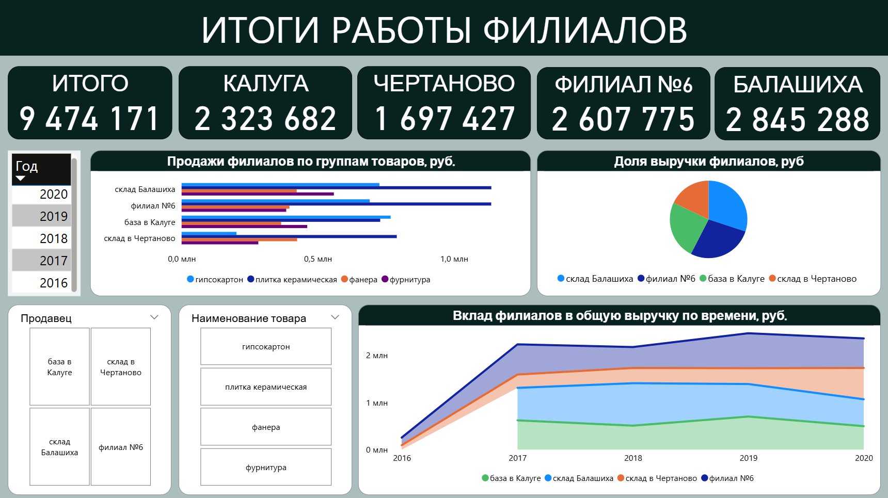

# Портфолио проектов

## Системный анализ и проектирование информационных систем

### 1. [Проектирование информационной системы кредитования юридических лиц — UML](https://docs.google.com/document/d/1wOCOlrayD03ZJKsjW4OphAhBMklj7WgY/edit?usp=sharing&ouid=100931746456580209218&rtpof=true&sd=true)

Выполнил проектирование информационной системы для автоматизации кредитования юридических лиц на примере банка ВТБ.

Исследовал процесс кредитования, выделил три роли участников и описал семь бизнес-прецедентов с основными и альтернативными сценариями.

Сформировал функциональные и нефункциональные требования к системе с классификацией по методологии FURPS+, указал приоритеты и риски реализации.

Разработал UML-диаграмму классов из 12 классов с разделением на Entity, Control и Boundary. Построил диаграммы Sequence и Activity для сценария оценки кредитоспособности клиента, включая проверку документов и обработку отказов.

Результатом стал комплект требований и UML-моделей, описывающий функциональность, структуру и поведение проектируемой информационной системы.

**Технологии:** UML, Use Case Diagram, Class Diagram, Sequence Diagram, Activity Diagram, FURPS+, системный анализ, проектирование ИС.

## BI и визуализация данных

### 1. [Анализ выручки филиалов компании в Power BI](materials/powerbi-branches.pbix)

Разработал интерактивный дашборд для анализа продаж и сравнения финансовых результатов четырех филиалов компании.

Реализовал KPI-карточки с показателями общей выручки и выручки отдельных филиалов, диаграммы структуры продаж по товарным категориям, распределения выручки между филиалами и динамики показателей за 2016–2020 годы.

Добавил фильтрацию по годам, филиалам и товарным категориям для детального анализа результатов деятельности компании.

**Технологии:** Power BI, BI-аналитика, визуализация данных, KPI, интерактивные фильтры.

### 2. [Анализ и визуализация данных продаж в Yandex DataLens](https://docs.google.com/document/d/1cjLnetFUdqu_pSI3xVlGCcpNj11Ty4ss/edit?usp=sharing&ouid=100931746456580209218&rtpof=true&sd=true)

Провел анализ продаж на основе датасета Online Retail Dataset с платформы Kaggle. Подготовил выборку из 2 000 записей и рассчитал выручку по каждой позиции заказа на основе количества товаров и цены за единицу.

Создал семь визуализаций и итоговый дашборд в Yandex DataLens для анализа динамики выручки, географии продаж, популярности товаров и количества уникальных покупателей.

**Технологии:** Yandex DataLens, Excel, Kaggle, анализ данных, визуализация данных.

[Посмотреть скриншот дашборда](https://drive.google.com/file/d/1ffCo6A2HNy9FNOhEg-FcPSwnoyjShKGk/view?usp=sharing)

### 3. [Анализ продаж и построение дашборда в Excel](materials/excel-sales-dashboard.xlsx)

Разработал аналитический дашборд в Microsoft Excel на основе данных о продажах товаров.

Подготовил сводные отчеты для анализа продаж по менеджерам, товарным позициям и регионам, а также динамики продаж по месяцам. Рассчитал ключевые показатели и реализовал инструменты фильтрации данных.

Объединил результаты анализа в дашборд для оценки структуры продаж, сравнения результатов менеджеров и выявления наиболее значимых товарных категорий.

**Технологии:** Microsoft Excel, сводные таблицы, анализ данных, KPI, визуализация.

## Python и машинное обучение

### 1. [Прогнозирование баланса клиентов банка с помощью машинного обучения](https://docs.google.com/document/d/1bhbrqZ8Q6LLcI_UslMjVsczINo4_GlTl/edit?usp=sharing&ouid=100931746456580209218&rtpof=true&sd=true)

Провел исследовательский анализ данных 10 000 клиентов банка на основе Bank Customer Churn Dataset с платформы Kaggle. Изучил распределение признаков, проверил качество данных и подготовил выборку для моделирования.

Построил и сравнил четыре регрессионные модели: парную линейную регрессию, множественную линейную регрессию, дерево решений и градиентный бустинг. Оценил качество прогнозирования по метрикам MAE, MSE, RMSE и R².

Наилучший результат показал градиентный бустинг (R² = 0,1456). Проанализировал ограничения моделей и определил необходимость дополнительных признаков для повышения точности прогнозирования.

**Технологии:** Python, pandas, NumPy, scikit-learn, Matplotlib, Seaborn, EDA, регрессионный анализ.

## Моделирование и анализ бизнес-процессов

### 1. [Моделирование бизнес-процессов кредитования юридических лиц — BPMN, IDEF0](https://docs.google.com/document/d/1E1JI_c4iKSpQ68Q7ZgvxWe-TxpoHAUkY/edit?usp=sharing&ouid=100931746456580209218&rtpof=true&sd=true)

Провел анализ бизнес-процесса управления услугами кредитования юридических лиц на примере банка ВТБ.

Исследовал организационную структуру банка, разработал карту бизнес-процессов и цепочку создания ценности. Описал последовательность операций по обработке кредитной заявки, взаимодействие участников процесса и возможные сценарии отказа.

Построил контекстную диаграмму IDEF0 и модель бизнес-процесса в нотации BPMN, отражающую этапы проверки документов, анализа кредитоспособности и принятия решения по кредиту.

Результатом стала модель текущего бизнес-процесса (AS-IS), позволяющая анализировать последовательность операций и определять направления возможной оптимизации.

**Технологии:** BPMN, IDEF0, бизнес-анализ, моделирование процессов AS-IS.

### 2. Моделирование процесса разработки рекламного продукта — IDEF0

Разработал функциональную модель бизнес-процесса рекламного агентства по выполнению индивидуального заказа на изготовление рекламного продукта.

Построил контекстную диаграмму и декомпозицию процесса в нотации IDEF0. Детализировал этапы обработки заказа, подготовки договора, разработки рекламного эскиза, согласования макета, тиражирования и передачи готовой продукции заказчику.

Для каждого этапа определил входные и выходные информационные потоки, управляющие воздействия и необходимые ресурсы.

**Технологии:** IDEF0, функциональное моделирование, декомпозиция бизнес-процессов.

**Диаграммы:**

- [Контекстная диаграмма IDEF0](images/idef0-advertising-1.jpg)
- [Декомпозиция процесса разработки рекламы](images/idef0-advertising-2.jpg)
- [Декомпозиция процесса обработки заказа](images/idef0-advertising-3.jpg)
- [Декомпозиция процесса подготовки договора](images/idef0-advertising-4.jpg)

### 3. Моделирование процесса экспресс-доставки отправлений — IDEF0

Разработал функциональную модель бизнес-процесса компании экспресс-доставки, охватывающую прием, обработку и доставку клиентских отправлений.

Построил контекстную диаграмму и декомпозицию бизнес-процесса с выделением основных функциональных блоков. Определил входящие и исходящие потоки, правила выполнения операций, участников и информационные системы, обеспечивающие работу процесса.

Детализировал процесс приема отправлений в офисах компании и у отправителей.

**Технологии:** IDEF0, моделирование бизнес-процессов, функциональная декомпозиция, бизнес-анализ.

**Диаграммы:**

- [Контекстная диаграмма процесса доставки](images/idef0-delivery-1.png)
- [Декомпозиция процесса доставки](images/idef0-delivery-2.png)
- [Детализация процесса приема отправлений](images/idef0-delivery-3.png)

### 4. [Моделирование процесса приема отправлений в офисах — EPC](images/epc-delivery.jpg)

Разработал модель процесса приема клиентских отправлений в офисах транспортной компании в нотации EPC.

Описал последовательность операций от поступления отправления до приема оплаты клиентом, включая проверку корректности оформления, обработку сопроводительных документов, присвоение регистрационного номера, замер габаритов и расчет стоимости доставки.

Отразил альтернативные сценарии при обнаружении ошибок в документах, события процесса и ответственного исполнителя — офис-менеджера.

**Технологии:** EPC, моделирование бизнес-процессов, анализ последовательности операций, событийное моделирование.

## Навыки и инструменты

**Анализ данных:** Python, pandas, NumPy, SQL (PostgreSQL), R (базовый уровень), Excel.

**BI и визуализация:** Power BI, Yandex DataLens, Loginom, Visiology, Excel, Google Таблицы.

**Бизнес- и системный анализ:** UML, BPMN, IDEF0, EPC, FURPS+, моделирование AS-IS.

**Инструменты:** MS Visio, Bizagi, Draw.io, Git, Jira.

## Контакты

**Email:** dmi-konyukhov@mail.ru

**Telegram:** [@dkonyukhov](https://t.me/dkonyukhov)
